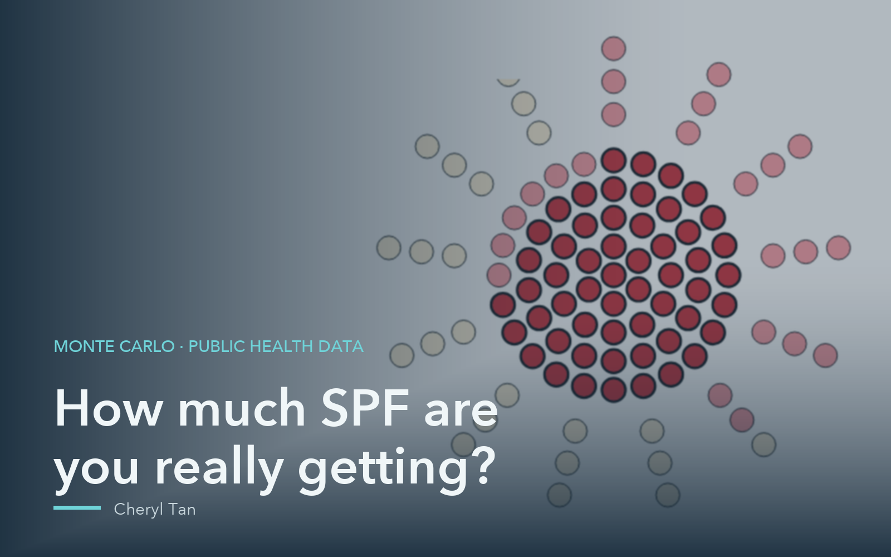
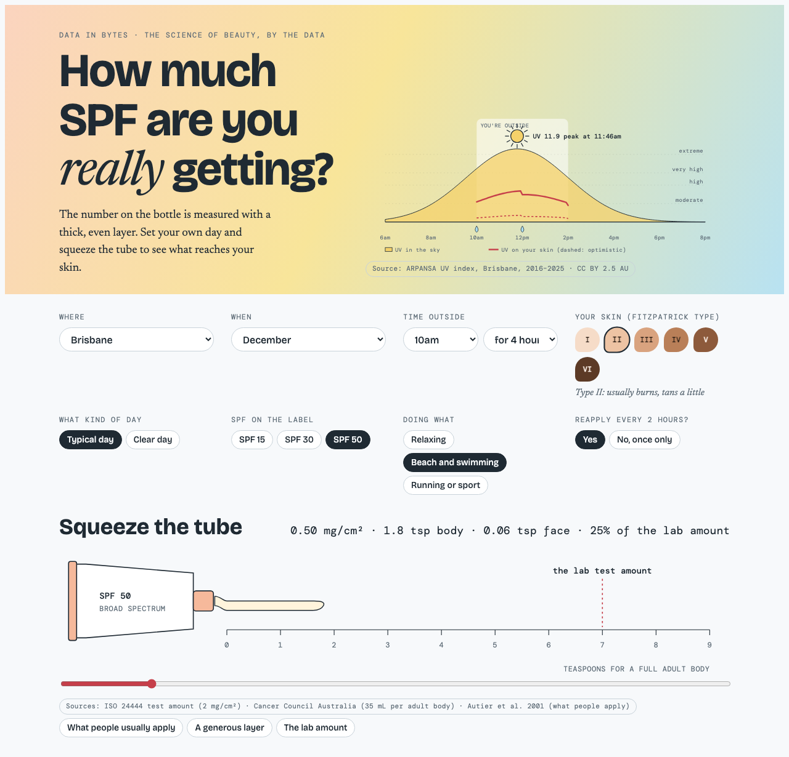
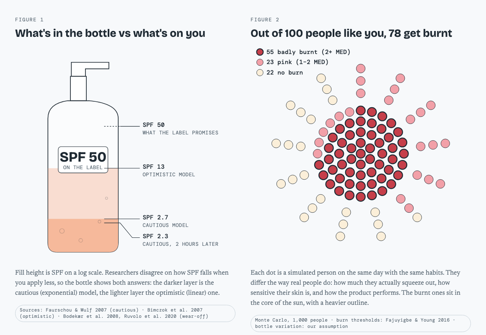

# How much SPF are you really getting?

An interactive simulator that shows how much sun protection people actually get from sunscreen, built on ten years of measured Australian UV data.

**Live page:** [cheryltky.github.io/real-world-spf](https://cheryltky.github.io/real-world-spf/)

## Project background

The SPF on a bottle is measured in a lab with a thick, even layer of 2 mg/cm². Studies of real use find people apply far less: a median of 0.39 mg/cm² in one study of European students. This project asks what that gap means for a day outside in an Australian city, and shows the answer as a page anyone can play with. It was made for my Instagram series *Data in Bytes: The Science of Beauty, by the data*, which takes its cue from Dr Michelle Wong's point that dose matters more than the ingredient list.

The simulator covers three areas:

- **Dose:** what SPF you actually get from the amount you apply, under the two published models.
- **Exposure:** how much sunburn-weighted UV reaches the skin across a day, by city, month and time outside.
- **Outcome:** how many of 100 people with your habits burn, given real differences between people and products.

Links to the technical work:

- UV data pipeline: [pipeline/build_uv_peaks.py](pipeline/build_uv_peaks.py)
- Model: [js/model.js](js/model.js), every assumption and its source: [data/parameters.json](data/parameters.json)
- Tests: [tests/](tests/) and [pipeline/test_build_uv_peaks.py](pipeline/test_build_uv_peaks.py)

## Data structure and initial checks

ARPANSA publishes one-minute UV index readings for Australian cities. The pipeline reads 2016 to 2025 for nine cities (90 yearly files, 1.8 GB) and reduces them to a 16 KB table of city × month:

- **Typical day:** the median daily peak.
- **Clear day:** the 90th percentile daily peak.
- **Shape of the day:** when the curve peaks and how wide it is.

Checks:

- **Incomplete days dropped:** days with fewer than 1,000 of 1,440 minutes are left out. Every city keeps at least 277 days per calendar month.
- **One-minute spikes ignored:** a 15-minute rolling median stops single-minute glitches setting the daily peak.
- **Clock checked:** the timestamps are local standard time all year. Sydney's January peak centres on 12:06 in the raw data. The page adds an hour in daylight-saving months.
- **Two file layouts handled:** the files use two header formats, and both are read.

## Executive summary

**At the amount people typically apply, SPF 50 behaves like SPF 2.7 to 13.** Researchers disagree on how protection falls with a thinner layer, so the page shows both models rather than pick one. On a typical December day in Brisbane, 4 hours at the beach from 10am with a 0.5 mg/cm² layer of SPF 50 reapplied every 2 hours, **78 of 100 simulated people burn**. At the lab amount, 10 do. The amount applied matters far more than reapplying the same thin layer.

## Insights deep dive

### Dose

- **The label assumes four times what people apply.** At 0.5 mg/cm², SPF 50 delivers SPF 2.7 under the cautious (exponential) model and SPF 13.3 under the optimistic (linear) one. At the median measured amount, 0.39 mg/cm², it delivers SPF 2.1 to 10.6.
- **Doubling the amount does more than any other choice.** At 1 mg/cm² the range rises to SPF 7.1 to 25.5.

### Exposure and outcome (Brisbane, December, type II skin, 10am to 2pm at the beach)

- **55 of 100 people are badly burnt and 23 go pink** at 0.5 mg/cm² with reapplying.
- **At the lab amount, 3 are badly burnt and 7 go pink.**
- **Reapplying the same thin layer barely helps:** 57 badly burnt when applied once, against 55 when reapplied. Measured wear-off is slow (protection halves in about 6.5 hours of swimming and activity), so the thin first layer, not wear-off, sets the dose.
- **SPF 30 instead of 50 raises badly burnt from 55 to 68.**
- **Place matters less than amount:** the same day in Hobart gives 49 badly burnt, against 55 in Brisbane.

Figures come from [scripts/scenarios.mjs](scripts/scenarios.mjs), which runs the same model and random people as the page.

## Recommendations

For anyone writing sun-safety messages:

- People under-apply by a factor of four, and that gap swamps the difference between SPF 30 and 50. **Lead with amount: about 7 teaspoons for a full adult body (Cancer Council Australia).**
- A thin layer reapplied stays thin. **Pair "reapply every 2 hours" with "and use enough".**
- The cautious and optimistic models disagree by a factor of five at typical amounts. **Present SPF at real-world amounts as a range, not a single number.**

## Assumptions and caveats

- **Teaching model, not advice.** The page gives no "safe time in the sun"; follow the SunSmart UV alert.
- **Wear-off evidence is thin.** It rests on two small studies, one of them industry-funded.
- **Burn thresholds are uncertain.** Thresholds for skin types V and VI are poorly studied, and self-reported skin type predicts real sensitivity poorly.
- **Product variation is an assumption.** How far a bottle strays from its label is our own choice, set wide because CHOICE found 16 of 20 SPF 50 products below their label in June 2025.
- **The UV curve is simplified.** The daily curve is a bell shape fitted to the brighter half of days, so cloudy days are not modelled minute by minute.
- **Hobart is approximate.** Its data comes from ARPANSA's Kingston station, just south of the city.

## Technical detail

- How to run it: [docs/SETUP.md](docs/SETUP.md)
- Model, sources and validation: [docs/METHODOLOGY.md](docs/METHODOLOGY.md)

## Data and licensing

UV data: ARPANSA Ultraviolet Radiation Index via data.gov.au, licensed CC BY 2.5 AU. The research sources are listed with DOIs in [data/parameters.json](data/parameters.json). Code is MIT licensed.
